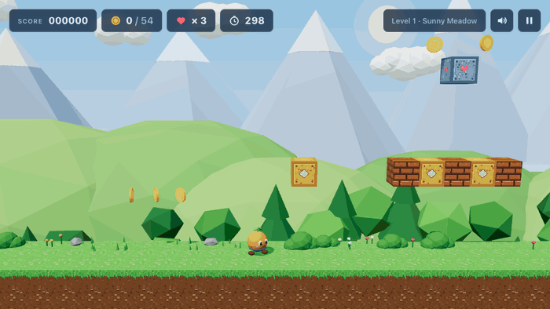

# Sprout Hop

[](https://github.com/hayrullah-zafer-yilmaz/sprout-hop/actions/workflows/ci.yml)
[](LICENSE)

A 2.5D side-scrolling platformer level built with [Vue 3](https://vuejs.org), [TresJS](https://tresjs.org) and [Three.js](https://threejs.org). The world is fully 3D, with depth, parallax and real shadows. Gameplay stays on a single 2D plane.

**[Play it in your browser](https://hayrullah-zafer-yilmaz.github.io/sprout-hop/)** · [Türkçe](docs/README.tr.md)



## Features

- **One full level**, about 220 tiles wide, with pits, stairs, one-way planks, spikes, a checkpoint, a horizontal and a vertical moving platform, and a flag at the end.
- **Tuned platformer controls**: acceleration and braking, a run button, variable jump height, coyote time and jump buffering.
- **Blocks you hit from below**: coin crates, life crates and breakable bricks.
- **Two enemy types**: slimes you can stomp, with stomp combos, and spiky rollers you have to jump over.
- **No asset files**: every texture is drawn on a canvas at startup and every sound is synthesized with the Web Audio API. Models are built from Three.js primitives.
- **Score, coins, lives and a timer**. Leftover time becomes bonus points, and the best score is kept in `localStorage`.
- **Keyboard and gamepad** input, a pause menu, and English and Turkish UI.

## Controls

| Action  | Keyboard                | Gamepad          |
| ------- | ----------------------- | ---------------- |
| Move    | `←` `→` or `A` `D`      | Left stick, D-pad |
| Jump    | `Space`, `W` or `↑`     | `A`              |
| Run     | `Shift`                 | `X`              |
| Pause   | `Esc` or `P`            | `Start`          |
| Restart | `R`                     |                  |
| Sound   | `M`                     |                  |

Hold the jump button to jump higher. Running also makes jumps a little longer.

## Getting started

Requires Node.js 22.12 or later.

```bash
npm install
npm run dev
```

Then open the URL that Vite prints.

| Script              | What it does                               |
| ------------------- | ------------------------------------------ |
| `npm run dev`       | Starts the dev server                      |
| `npm run build`     | Type-checks and builds to `dist/`          |
| `npm run preview`   | Serves the production build                |
| `npm run typecheck` | Runs `vue-tsc`                             |
| `npm test`          | Runs the Vitest suite                      |

Add `?lang=en` or `?lang=tr` to the URL to pick the UI language.

## How it works

The game logic and the rendering are kept apart.

- **`src/game/`** holds the rules in plain TypeScript, with no Three.js and no Vue:
  - `config.ts`: physics and rules
  - `collision.ts`: AABB collision against the tile grid
  - `entities.ts`: entity types and factories
  - `world.ts`: the game loop rules

  The world advances in fixed steps of 1/120 s. Because it is plain code, Vitest tests it directly, and one test plays through the whole level with a small bot.
- **`src/components/scene/LevelScene.vue`** creates a world for each run and steps it from TresJS's `useLoop().onBeforeRender`. Named priorities in `src/scene/context.ts` set the order inside each frame: the world steps first, the models then copy its state, and the camera and the sky follow last.
- **The static scenery** (sky, mountains, hills, a forest in the valley, clouds, bushes and flowers) is generated once from a seeded random generator and survives restarts. Only the parts that change during a run are rebuilt.
- **Draw calls are kept low**:
  - Tiles, coins, clouds, effects and scenery are drawn with `InstancedMesh`.
  - Enemies share their geometries and materials.
  - Paired parts such as eyes are merged into one geometry.
  - A typical frame needs about 65 draw calls.
- **Vue reactivity is used only for the HUD and menus.** The 3D models render once and are then moved through template refs every frame.

## Editing the level

The level is an ASCII map in [`src/game/level.ts`](src/game/level.ts). Each character is one tile, and the bottom row is `y = 0`.

| Char | Meaning |
| ---- | ------- |
| `#`  | Ground (grass on top, dirt below) |
| `X`  | Stone block |
| `B`  | Brick, breaks when hit from below |
| `C`  | Coin crate |
| `L`  | Life crate |
| `-`  | One-way plank: you can jump through it from below |
| `o`  | Coin |
| `s`  | Slime |
| `k`  | Spiky roller |
| `^`  | Spikes |
| `m` … `M` | Horizontal moving platform: start and end on the same row |
| `v` … `V` | Vertical moving platform: start and end in the same column |
| `K`  | Checkpoint |
| `P`  | Player start |
| `F`  | Goal flag |

With the default physics, a held jump reaches just over 4 tiles high. A walking jump clears a gap of 5 tiles and a running jump a gap of 8. After you change the map, `npm test` tells you whether the bot can still finish it.

## Project structure

```
src/
  game/              rules in plain TypeScript: config, level, entities, collision, world
  scene/             Three.js builders and shared assets: textures, tiles, scenery, models, flag
  app/               browser state and services: UI store, i18n, input, audio
  components/scene/  Tres components that draw the world
  components/ui/     Vue HUD and menus
tests/               Vitest suites for collision, the world rules and a full-level bot run
```

## Deployment

`.github/workflows/pages.yml` builds the game and publishes it to GitHub Pages on every push to `main`. In the repository settings, under **Pages**, set **Source** to **GitHub Actions**. The Vite `base` is `./`, so the build works under any repository name.

## License

[MIT](LICENSE)
