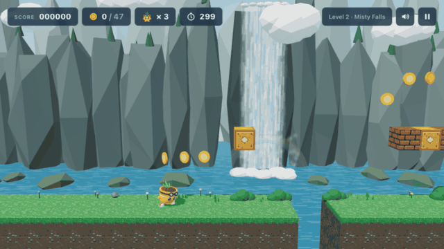

# Sprout Hop

[](https://github.com/hayrullah-zafer-yilmaz/sprout-hop/actions/workflows/ci.yml)
[](LICENSE)

A 2.5D side-scrolling platformer built with [Vue 3](https://vuejs.org), [TresJS](https://tresjs.org) and [Three.js](https://threejs.org). The world is fully 3D, with depth, parallax and real shadows. Gameplay stays on a single 2D plane.

**[Play it in your browser](https://hayrullah-zafer-yilmaz.github.io/sprout-hop/)** · [Türkçe](docs/README.tr.md)


## Features

- **Three potted heroes to choose from**, true to the name: each one is a little flower pot with a sprout growing out of its soil. A live 3D preview shows the hero you pick. Each hero has big glossy eyes and a face that follows the action: they blink, squint while running, gasp in the air and cheer at the flag.
  - **Sprout**, a terracotta pot with two big leaves, is balanced.
  - **Zip**, a yellow pot with goggles on its rim and swept-back leaves, runs the fastest.
  - **Bun**, a cream pot with a pink rim and two long leaves like bunny ears, jumps the highest and glides while you hold jump.
- **Three levels**, each with its own look and its own best score. When you finish a level, the next one starts after a five-second countdown, and the hero screen lets you pick any level.
  - **Sunny Meadow** is about 220 tiles wide, with pits, stairs, one-way planks, spikes, a checkpoint, a horizontal and a vertical moving platform, and a flag at the end.
  - **Misty Falls** is a river canyon about 200 tiles wide, with stepping stones, a wooden bridge, a lift and a moving platform over the river. In the background, three waterfalls pour into the river, with rising mist, foam and a rainbow.
  - **Magma Mountain** is a path over a lava lake, about 210 tiles wide, with basalt columns, a plank bridge, a lift and a moving platform. Rocks fall from the sky: a growing shadow and crumbling pebbles mark where each one will land, and a rock that hits the hero costs a life. Behind it, a smoking volcano, drifting smoke, lava falls that pour out of the cliffs, and rising embers.
- **Tuned platformer controls**: acceleration and braking, a run button, variable jump height, coyote time and jump buffering.
- **Blocks you hit from below**: coin crates, life crates and breakable bricks.
- **Two enemy types**: slimes you can stomp, with stomp combos, and spiky rollers you have to jump over.
- **No asset files**: every texture is drawn on a canvas at startup and every sound is synthesized with the Web Audio API. Models are built from Three.js primitives, and the heroes' faces are drawn on a canvas too.
- **Score, coins, lives and a timer**. Leftover time becomes bonus points, and the best score of each level is kept in `localStorage`.
- **Keyboard and gamepad** input, a pause menu, and English and Turkish UI.




## Controls

| Action       | Keyboard                       | Gamepad           |
| ------------ | ------------------------------ | ----------------- |
| Choose hero  | `←` `→` on the hero screen     | Left stick, D-pad |
| Choose level | `↑` `↓` on the hero screen     | Left stick, D-pad |
| Move         | `←` `→` or `A` `D`             | Left stick, D-pad |
| Jump         | `Space`, `W` or `↑`            | `A`               |
| Glide (Bun)  | Hold jump while falling        | Hold `A`          |
| Run          | `Shift`                        | `X`               |
| Pause        | `Esc` or `P`                   | `Start`           |
| Restart      | `R`                            |                   |
| Sound        | `M`                            |                   |

Hold the jump button to jump higher. Running also makes jumps a little longer.

## Getting started

Requires Node.js 22.12 or later.

```bash
npm install
npm run dev
```

Then open the URL that Vite prints.

| Script              | What it does                               |
| ------------------- | ------------------------------------------ |
| `npm run dev`       | Starts the dev server                      |
| `npm run build`     | Type-checks and builds to `dist/`          |
| `npm run preview`   | Serves the production build                |
| `npm run typecheck` | Runs `vue-tsc`                             |
| `npm test`          | Runs the Vitest suite                      |

Add `?lang=en` or `?lang=tr` to the URL to pick the UI language.

## How it works

The game logic and the rendering are kept apart.

- **`src/game/`** holds the rules in plain TypeScript, with no Three.js and no Vue:
  - `config.ts`: physics and rules
  - `characters.ts`: the three heroes and their movesets
  - `level.ts` and `levels/`: the map parser, and the level maps in the order they are played
  - `collision.ts`: AABB collision against the tile grid
  - `entities.ts`: entity types and factories
  - `world.ts`: the game loop rules

  The world advances in fixed steps of 1/120 s. Because it is plain code, Vitest tests it directly, and a small bot plays through every level with every hero.
- **`src/components/scene/LevelScene.vue`** creates a world for each run and steps it from TresJS's `useLoop().onBeforeRender`. Named priorities in `src/scene/context.ts` set the order inside each frame: the world steps first, the models then copy its state, and the camera and the sky follow last.
- **Each level has a theme** in `src/scene/themes.ts`: the sky, fog, light, tile and plant colors, and which backdrop to build. The static scenery is generated once per level from a seeded random generator and survives restarts. The meadow gets hills and a forest in the valley. The falls and Magma Mountain share a canyon builder (`src/scene/canyon.ts`) for cliffs, falls of water or lava, foam and the sea below, all moving every frame. Magma Mountain swaps the clouds and the sun for drifting smoke, and adds a smoking volcano and rising embers (`src/scene/volcano.ts`), with light basalt platforms that stand out against the lava. Only the parts that change during a run are rebuilt.
- **The heroes** share one pot: a round belly turned from a profile, with a rim band and soil on top. They differ in glaze, plant, gear and face (`src/scene/hero.ts`, `heroKit.ts`, `heroGear.ts`). The leaves are extruded shapes with veins drawn on a canvas. Each face is a canvas atlas of eight expressions projected onto the pot, and the model picks one from the game state every frame (`heroFace.ts`). A thin outline and a soft rim light keep the heroes readable against busy backgrounds.
- **Draw calls are kept low**:
  - Tiles, coins, clouds, effects and scenery are drawn with `InstancedMesh`.
  - Enemies share their geometries and materials.
  - Paired parts such as eyes are merged into one geometry.
  - A typical frame needs about 70 draw calls in the meadow, 80 at the falls and 100 on Magma Mountain.
- **Vue reactivity is used only for the HUD and menus.** The 3D models render once and are then moved through template refs every frame.

## Editing the levels

The levels are ASCII maps in [`src/game/levels/`](src/game/levels/), one file per level. Each character is one tile, and the bottom row is `y = 0`.

| Char | Meaning |
| ---- | ------- |
| `#`  | Ground (grass on top, dirt below) |
| `X`  | Stone block |
| `B`  | Brick, breaks when hit from below |
| `C`  | Coin crate |
| `L`  | Life crate |
| `-`  | One-way plank: you can jump through it from below |
| `o`  | Coin |
| `s`  | Slime |
| `k`  | Spiky roller |
| `^`  | Spikes |
| `r`  | Falling rock: drops into this column again and again, after a warning |
| `m` … `M` | Horizontal moving platform: start and end on the same row |
| `v` … `V` | Vertical moving platform: start and end in the same column |
| `K`  | Checkpoint |
| `P`  | Player start |
| `F`  | Goal flag |

With the default physics, a held jump reaches just over 4 tiles high. A walking jump clears a gap of 5 tiles and a running jump a gap of 8. After you change a map, `npm test` tells you whether the bot can still finish every level with every hero.

To add a level, put its map in a new file in `src/game/levels/` and register it in `index.ts` there. Then give it a theme in `src/scene/themes.ts` and a name in `src/app/i18n.ts`. TypeScript reports anything that is still missing.

## Project structure

```
src/
  game/              rules in plain TypeScript: config, map parser, entities, collision, world
  game/levels/       the ASCII level maps and the order they are played in
  scene/             Three.js builders and shared assets: textures, themes, tiles, scenery, canyons, volcano, heroes, models, flag
  app/               browser state and services: UI store, i18n, input, audio
  components/scene/  Tres components that draw the world
  components/ui/     Vue HUD and menus
tests/               Vitest suites for collision, the world rules, the heroes and a bot run through every level with every hero
```

## Deployment

`.github/workflows/pages.yml` builds the game and publishes it to GitHub Pages on every push to `main`. In the repository settings, under **Pages**, set **Source** to **GitHub Actions**. The Vite `base` is `./`, so the build works under any repository name.

## License

[MIT](LICENSE)
