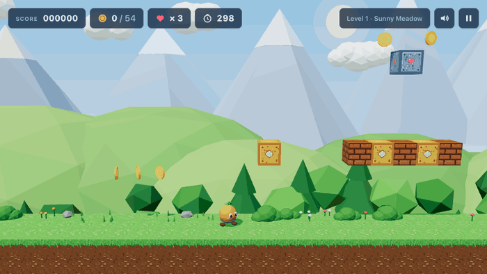

# Sprout Hop

[](https://github.com/hayrullah-zafer-yilmaz/sprout-hop/actions/workflows/ci.yml)
[](../LICENSE)

[Vue 3](https://vuejs.org), [TresJS](https://tresjs.org) ve [Three.js](https://threejs.org) ile yapılmış, yandan kaydırmalı bir 2.5D platform oyunu bölümü. Dünya tamamen 3D: derinlik, paralaks ve gerçek gölgeler var. Oynanış ise tek bir 2D düzlemde kalır.

**[Tarayıcıda oynayın](https://hayrullah-zafer-yilmaz.github.io/sprout-hop/)** · [English](../README.md)



## Özellikler

- **Seçilebilen üç kahraman**: Sprout dengelidir, Zip en hızlı koşar, Bun en yükseğe zıplar ve zıplama tuşunu basılı tuttuğunuzda süzülür. Seçtiğiniz kahraman canlı bir 3B önizlemeyle gösterilir.
- **Eksiksiz bir bölüm**: yaklaşık 220 karo genişliğinde. Çukurlar, merdivenler, tek yönlü kalaslar, dikenler, bir kontrol noktası, biri yatay biri dikey iki hareketli platform ve sonunda bir bayrak var.
- **İnce ayarlı platform kontrolleri**: hızlanma ve frenleme, koşma tuşu, basılı tutma süresine göre değişen zıplama yüksekliği, "coyote time" ve zıplama tamponu.
- **Alttan vurulan bloklar**: altın sandıkları, can sandıkları ve kırılan tuğlalar.
- **İki düşman türü**: üstüne basılarak yenilen jöleler (art arda basınca puan katlanır) ve üstünden atlanması gereken dikenli toplar.
- **Hiç asset dosyası yok**: tüm dokular açılışta bir canvas üzerine çizilir, tüm sesler Web Audio API ile sentezlenir. Modeller Three.js temel geometrileriyle kurulur.
- **Puan, altın, can ve süre**. Kalan süre bonus puana dönüşür, en iyi puan `localStorage` içinde saklanır.
- **Klavye ve oyun kumandası** desteği, duraklatma menüsü, İngilizce ve Türkçe arayüz.

## Kontroller

| Eylem             | Klavye                                | Oyun kumandası          |
| ----------------- | ------------------------------------- | ----------------------- |
| Kahraman seçme    | Kahraman ekranında `←` `→`            | Sol analog, yön tuşları |
| Hareket           | `←` `→` veya `A` `D`                  | Sol analog, yön tuşları |
| Zıplama           | `Space`, `W` veya `↑`                 | `A`                     |
| Süzülme (Bun)     | Düşerken zıplama tuşunu basılı tutun  | `A` basılı              |
| Koşma             | `Shift`                               | `X`                     |
| Duraklatma        | `Esc` veya `P`                        | `Start`                 |
| Yeniden başlatma  | `R`                                   |                         |
| Ses               | `M`                                   |                         |

Daha yükseğe zıplamak için zıplama tuşunu basılı tutun. Koşarken yapılan zıplamalar biraz daha uzağa gider.

## Başlarken

Node.js 22.12 veya daha yeni bir sürüm gerekir.

```bash
npm install
npm run dev
```

Ardından Vite tarafından yazılan adresi açın.

| Komut               | Ne yapar                                         |
| ------------------- | ------------------------------------------------ |
| `npm run dev`       | Geliştirme sunucusunu başlatır                   |
| `npm run build`     | Tip denetimi yapar ve `dist/` klasörüne derler   |
| `npm run preview`   | Üretim derlemesini sunar                         |
| `npm run typecheck` | `vue-tsc` çalıştırır                             |
| `npm test`          | Vitest testlerini çalıştırır                     |

Arayüz dilini seçmek için adrese `?lang=en` veya `?lang=tr` ekleyin.

## Nasıl çalışır

Oyun mantığı ile çizim birbirinden ayrıdır.

- **`src/game/`** kuralları Three.js ve Vue içermeyen düz TypeScript ile tutar:
  - `config.ts`: fizik ve kurallar
  - `characters.ts`: üç kahraman ve hareket özellikleri
  - `collision.ts`: karo ızgarasına karşı AABB çarpışması
  - `entities.ts`: varlık tipleri ve oluşturucuları
  - `world.ts`: oyun kuralları

  Dünya 1/120 saniyelik sabit adımlarla ilerler. Düz kod olduğu için Vitest onu doğrudan test eder; testlerden biri küçük bir botla bölümün tamamını oynar.
- **`src/components/scene/LevelScene.vue`** her oyun için bir dünya oluşturur ve onu TresJS `useLoop().onBeforeRender` döngüsü içinde ilerletir. Karedeki sırayı `src/scene/context.ts` içindeki adlandırılmış öncelikler belirler: önce dünya ilerler, sonra modeller onun durumunu kopyalar, en son kamera ve gökyüzü takip eder.
- **Statik manzara** (gökyüzü, dağlar, tepeler, vadideki orman, bulutlar, çalılar ve çiçekler) tohumlu bir rastgele sayı üreteciyle bir kez oluşturulur ve yeniden başlatmalarda korunur. Yalnızca oyun sırasında değişen parçalar yeniden kurulur.
- **Çizim çağrısı sayısı düşük tutulur**:
  - Karolar, altınlar, bulutlar, efektler ve manzara `InstancedMesh` ile çizilir.
  - Düşmanlar geometri ve materyallerini paylaşır.
  - Gözler gibi çift parçalar tek geometride birleştirilir.
  - Tipik bir kare yaklaşık 65 çizim çağrısıyla çizilir.
- **Vue reaktivitesi yalnızca HUD ve menüler için kullanılır.** 3B modeller bir kez çizilir, sonra her karede template ref üzerinden hareket ettirilir.

## Bölümü düzenlemek

Bölüm, [`src/game/level.ts`](../src/game/level.ts) içindeki bir ASCII haritadır. Her karakter bir karodur, en alt satır `y = 0` konumudur.

| Karakter | Anlamı |
| -------- | ------ |
| `#`  | Zemin (üstü çimen, altı toprak) |
| `X`  | Taş blok |
| `B`  | Tuğla, alttan vurulunca kırılır |
| `C`  | Altın sandığı |
| `L`  | Can sandığı |
| `-`  | Tek yönlü kalas: alttan içinden geçip zıplayabilirsiniz |
| `o`  | Altın |
| `s`  | Jöle |
| `k`  | Dikenli top |
| `^`  | Dikenler |
| `m` … `M` | Yatay hareketli platform: başlangıç ve bitiş aynı satırda |
| `v` … `V` | Dikey hareketli platform: başlangıç ve bitiş aynı sütunda |
| `K`  | Kontrol noktası |
| `P`  | Oyuncunun başlangıç yeri |
| `F`  | Bitiş bayrağı |

Varsayılan fizikle, basılı tutulan bir zıplama 4 karodan biraz daha yükseğe çıkar. Yürürken yapılan zıplama 5 karoluk, koşarken yapılan zıplama 8 karoluk bir boşluğu geçer. Haritayı değiştirdikten sonra `npm test`, botun bölümü her kahramanla hala bitirip bitiremediğini söyler.

## Proje yapısı

```
src/
  game/              düz TypeScript ile kurallar: ayarlar, bölüm, varlıklar, çarpışma, dünya
  scene/             Three.js kurucuları ve paylaşılan parçalar: dokular, karolar, manzara, modeller, bayrak
  app/               tarayıcı durumu ve servisler: arayüz durumu, i18n, giriş, ses
  components/scene/  dünyayı çizen Tres bileşenleri
  components/ui/     Vue HUD ve menüler
tests/               çarpışma, dünya kuralları, kahramanlar ve her kahramanla tüm bölümü oynayan bot için Vitest testleri
```

## Yayınlama

`.github/workflows/pages.yml`, `main` dalına yapılan her push sonrasında oyunu derler ve GitHub Pages üzerinde yayınlar. Depo ayarlarındaki **Pages** bölümünde **Source** seçeneğini **GitHub Actions** yapın. Vite `base` değeri `./` olduğu için derleme her depo adıyla çalışır.

## Lisans

[MIT](../LICENSE)
